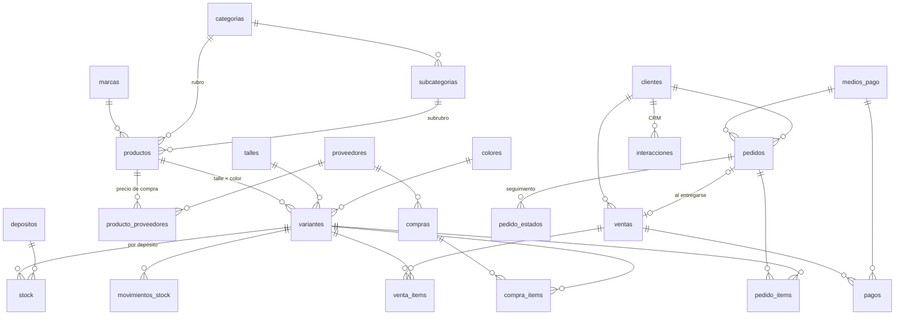

# Modelo de datos

Todo vive en **una migración**: [`supabase/migrations/20261011000000_inicial.sql`](../supabase/migrations/20261011000000_inicial.sql).
Este documento explica el *porqué*; el SQL es la verdad.

## Idea general: un modelo estrella

Como un modelo semántico de Power BI: **hechos** (lo que pasa, con importes y cantidades) que
apuntan a **dimensiones** (de qué, a quién, cómo).

| hechos | dimensiones |
|---|---|
| `venta_items`, `compra_items`, `pedido_items`, `movimientos_stock`, `pagos` | `productos` (→ `marcas`, `categorias`, `subcategorias`), `variantes` (→ `talles`, `colores`), `clientes`, `proveedores`, `depositos`, `medios_pago`, fecha, canal |

Para analizar (Excel, Power BI, Looker Studio) está la vista **`v_hechos_ventas`**: cada par
vendido con todas sus dimensiones ya unidas, y `importe_neto` / `margen_neto` con el descuento y el
ajuste por medio de pago prorrateados.



## El artículo, en dos niveles

- **`productos`** = el **modelo** («Zapatilla Running Pro», Nike, rubro Zapatilla, subrubro
  Running). Lo común a todos los talles y colores: precio de compra, precio de venta, foto,
  descripción, si se publica en la tienda.
- **`variantes`** = el **artículo vendible (SKU)**: modelo + talle + color. Tiene su propio stock,
  su SKU (`ZAP-0003-42-NEG`) y, si hace falta, un precio propio (si es `null`, vale el del modelo).

Talles y colores son **tablas**, no texto: así «Negro» es uno solo, los talles se ordenan bien
(38 < 38.5 < 39 por la columna `orden`) y la tienda puede ofrecer solo los que tienen stock.

## Escalas de talles

`productos.escala` (Adulto, Niños, Bebé) dice qué talles puede tener el artículo: solo los de
`talles.tipo` igual a su escala (lo frena un trigger, y un artículo no cambia de escala si ya tiene
talles de la otra). El nombre del talle es único **por escala**: el 34 de niños y el 34 de adulto son
dos talles distintos. La escala es independiente del género (una juvenil puede ser Niños y llegar al 36).

## Calzado y ropa

Un solo modelo para los dos: artículo → variantes talle × color. Lo que los distingue es la **escala** del
artículo (Adulto, Niños, Bebé para calzado; Ropa letras, Ropa números y Único para ropa) y la **línea** de su
rubro (Calzado, Ropa, Accesorios). La ropa suma temporada y material. Los informes agrupan por línea,
rubro, temporada, género, marca, modelo, talle (con su escala), color, canal, vendedor, promoción y cliente.
Datos demo: `supabase/demo/ropa.sql` (prendas reales de Dexter y Zara con su foto y precio).

## Fotos

`producto_imagenes` = la galería de un modelo: `url`, `ruta` (dónde está en el bucket `productos`;
null si es un link externo), `orden` y `principal`. La primera foto nace principal; marcar otra
desmarca la anterior; si se borra la principal, pasa a serlo la primera que queda. Los triggers
copian la url de la principal a `productos.imagen_url`, que es lo que usan `v_catalogo`, el carrito
y las vistas previas. La tienda ve la galería por `v_imagenes_tienda` (solo productos publicados).

## Portada de la tienda (landing)

La página de inicio (`/`) se arma con `inicio_secciones`: cada fila es una sección con su `tipo`
(`portada`, `cinta`, `accesos`, `productos`, `promociones`, `banner`, `editorial`, `pasos`, `local`), su `orden`,
`visible`, textos (`titulo`, `bajada`, `boton_texto`, `boton_enlace`), una foto o un video opcional (`imagen_url`,
`imagen_ruta` en el bucket público `tienda`; video mp4/webm hasta 50 MB en portada y banner) y lo propio del tipo en `contenido` (jsonb: tarjetas de
accesos, pasos, frases de la cinta, criterio de la vidriera…). La forma de `contenido` la valida
`lib/inicio.ts` (`leerContenido`), que nunca falla: lo que no cuadra vuelve a un valor por defecto.
Se edita en `/admin/tienda` con el permiso `tienda.editar`, igual que `configuracion_tienda` (nombre,
`avisos` de arriba —hasta 5, rotan—, Instagram, WhatsApp, dirección y horario). La vidriera «más vendidos» usa
`mas_vendidos_tienda()`: devuelve solo el orden de los artículos publicados, no cantidades ni montos.

## Precios

| dónde | qué es |
|---|---|
| `productos.precio_venta` | precio de lista (sin descuentos) |
| `variantes.precio_venta` | opcional, pisa al del modelo para ese talle/color |
| `productos.precio_compra` | el **último** que se pagó; es el que se usa para el margen |
| `producto_proveedores` | lo que cobra **cada** proveedor: `precio_lista`, `bonificacion_pct` y `precio_compra` (calculado). Uno es el `principal` |
| `venta_items.costo_unitario` | foto del precio de compra al vender (el margen histórico no cambia) |

## Medios de pago: descuentos y recargos

`medios_pago` tiene `ajuste_pct` (−10 = 10 % de descuento; +15 = recargo), `cuotas`, y dónde se
ofrece (`en_mostrador`, `en_tienda`). Una venta puede pagarse con varios:

```
Venta $100.000 → $60.000 en efectivo (−10 %) + $40.000 en 3 cuotas (+15 %)
  pago 1: base 60.000 · ajuste −6.000 · monto 54.000
  pago 2: base 40.000 · ajuste +6.000 · monto 46.000
  ventas: subtotal 100.000 · descuento 0 · ajuste_medio_pago 0 · total 100.000
```

`base` = qué parte del precio cubre; `monto` = lo que entró a caja. El % se **copia** en cada pago
(y en el pedido), así cambiarlo mañana no altera lo ya vendido ni lo prometido. Si la suma de las
`base` no llega al total, la diferencia queda como **saldo sin cobrar**.

## Claves y borrado

- **PK**: `id` autonumérico en todas (salvo `stock`, `(variante_id, deposito_id)`, y `numeradores`).
  Nunca se escribe a mano.
- **FK**: `<tabla_en_singular>_id`, todas con índice.
- **Código visible** (`codigo`): lo que busca la gente. Único, en mayúsculas, se genera solo si
  queda vacío.
- **Borrado**: lo que tiene historia es `restrict` (se desactiva en vez de borrarse). `cascade`
  solo para lo que es parte de otra fila: renglones de venta/compra/pedido, pagos de una venta,
  estados de un pedido, el stock de una variante, las notas de un cliente, los precios de un
  proveedor para un artículo.

## Comprobantes

`ventas`, `pedidos`, `presupuestos` y `compras` se numeran con la tabla `numeradores` (por tipo y punto de venta,
con `FOR UPDATE`): `0001-00000123`. Las compras guardan además el número y la fecha de la
**factura del proveedor** (`comprobante_proveedor`, `fecha_comprobante`).

### Los documentos del local (ninguno tiene validez fiscal)

| documento | tabla | qué es | toca stock |
|---|---|---|---|
| **Presupuesto** | `presupuestos` + `presupuesto_items` | lo que se ofrece y a qué precio; congela precios y promociones hasta `valido_hasta` | no |
| **Pedido** (web) | `pedidos` | un presupuesto que el cliente confirmó desde la tienda | reserva |
| **Comprobante de venta** | `ventas` | lo que se entregó y se cobró | descuenta |
| **Devolución** | `devoluciones` + `devolucion_items` | lo que vuelve de una venta (`DEV 0001-…`); deja saldo a favor en `saldos_cliente` | devuelve (lo fallado, a Fallados) |
| **Recibo** | (pendiente) | constancia de cada cobro, para saldos y pagos parciales | no |

`crear_presupuesto` arma el presupuesto con el mismo motor que la caja (`_renglones_cotizados`);
`convertir_presupuesto` lo pasa a venta respetando lo presupuestado (`_registrar_venta`), y si ya
venció avisa que hay que hacer uno nuevo. Estados: `vigente`, `convertido`, `anulado`; «vencido» se
calcula por la fecha. Se escribe solo por esas funciones (permiso `ventas.registrar`).

## Stock

Los depósitos tienen `vendible`: «Local» vende, «Fallados» no (un trigger frena ahí ventas, compras, ajustes y
reservas). `v_stock` y `v_catalogo` cuentan solo los que venden. `fallados` guarda cada tanda apartada (motivo, costo
de ese momento, origen) hasta su salida: `arreglado`, `proveedor` (crédito a su costo) o `baja` (pérdida).

**Crédito con proveedores.** `creditos_proveedor` es un libro de movimientos por proveedor (como
`saldos_cliente`): `devolucion` (+, lo genera `resolver_fallado` con el costo del fallado; `fallado_id` único),
`descuento` (−, `aplicar_credito_proveedor` sobre una compra suya) y `ajuste` (±, con nota obligatoria). El saldo
es la suma y nunca queda negativo (se bloquea el proveedor con `FOR UPDATE`). En la compra, `credito_aplicado`
(entre 0 y el `total`, lo valida un `check`): lo que se le paga es `total − credito_aplicado`; el costo de los
renglones no cambia. `v_credito_proveedores` (saldo, a favor, usado) solo para `compras.registrar` o `costos.ver`.
Tipos de movimiento: `venta`, `compra`, `ajuste`, `anulacion`, `transferencia`, `devolucion_proveedor`, `baja`.

`stock(variante, depósito)` tiene `cantidad` y `reservado` (comprometido en pedidos web).
`disponible = cantidad − reservado`. Solo lo mueven las funciones (`registrar_venta`,
`registrar_compra`, `ajustar_stock`, `crear_pedido`, `cambiar_estado_pedido`), y cada movimiento
queda en `movimientos_stock`. Siempre: `stock.cantidad = Σ movimientos`.

## Seguridad (Row Level Security)

| quién | ve |
|---|---|
| equipo (`perfiles.rol = 'staff'` + `rol_id`) | lo que su rol permite (`tiene_permiso('…')`); los costos solo con `costos.ver` |
| cliente registrado | su ficha, sus pedidos (con sus renglones y su seguimiento) |
| cualquiera (sin cuenta) | `v_catalogo` (sin costos), los `medios_pago` habilitados en la tienda, las `inicio_secciones` visibles y `configuracion_tienda` |


## Cuentas de clientes y correo

| tabla | para qué |
|---|---|
| `configuracion_cuentas` (una fila, lectura pública) | registro abierto o por invitación, datos que pide el formulario, contraseña, dominios de email, términos y confirmación de email |
| `invitaciones_cuenta` | links de un solo uso (`token`) atados a un email, con rol opcional; vencen a los 7 días. Solo el Administrador las ve |
| `perfiles.terminos_aceptados_en` | cuándo aceptó los términos |
| `integraciones.smtp_*` | el servidor de correo del local (nadie lo lee; `estado_correo()` muestra los últimos 4) |

Funciones: `validar_registro()` (anon), `invitacion_info()` (anon, requiere el token), `crear_invitacion()`, `anular_invitacion()`,
`guardar_correo()`, `estado_correo()` y `cuentas_aplicar()` (pasa a Supabase Auth: confirmación, contraseña, SMTP y plantillas).
El trigger `antes_de_registrarse` en `auth.users` hace cumplir las reglas aunque se salteen el formulario.
